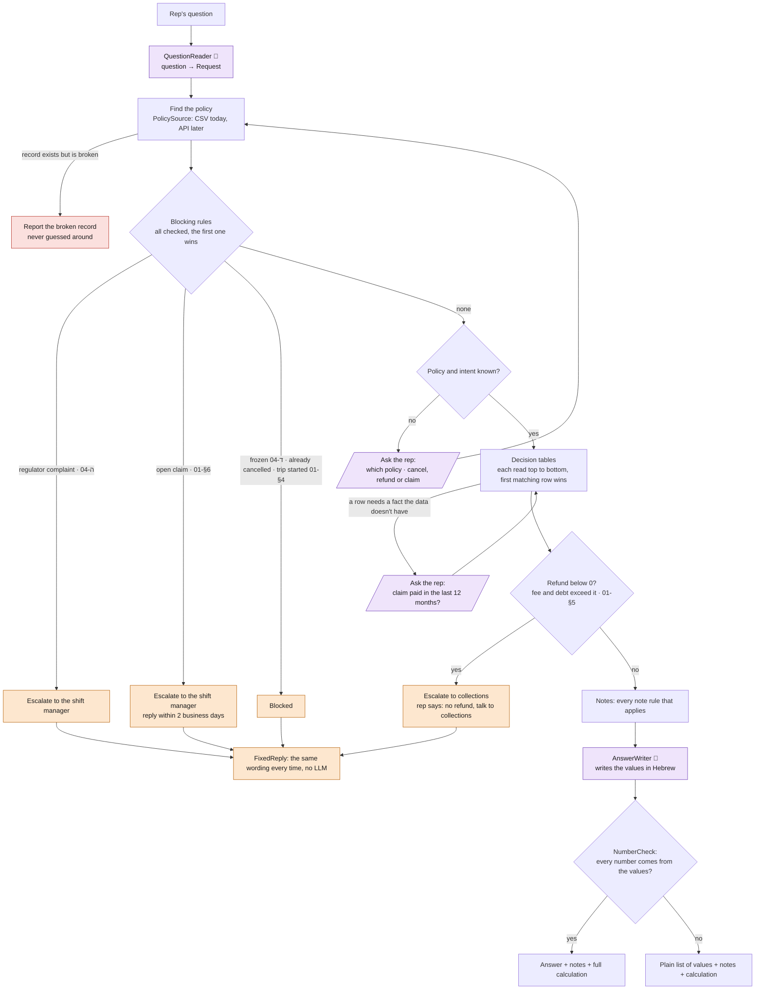

# Rep assistant

A CLI for insurance customer-service reps. The rep types a free-text question
(Hebrew or English), for example `לקוח 4471 רוצה לבטל, מה מגיע לו?`. The tool answers
from that policy's data and the company's procedures. If a case is above the rep's
authority, it routes it to a manager instead of answering.

## Why it's built this way

The rep is live on the phone, and a wrong answer about money becomes a complaint to the
regulator. So the model never decides anything:

- **The LLM only reads and writes.** It turns the question into a fixed form and words
  the answer. Every decision and amount comes from a rulebook in code, where each rule
  cites its procedure section.
- **Nothing is invented.** Missing data is reported as unknown. If the written answer has a
  number that isn't in the calculated values or the policy data, it's thrown out.
- **Cases above the rep's authority are routed, not answered,** with the same wording
  every time.
- **The data source is swappable.** Policy data comes through one interface: the CSV
  today, the company's policy API later.
- **Fast:** a median answer takes about 3 seconds.

## Requirements

- Python 3.12+
- An OpenAI API key in `code/.env`: `OPEN_AI_API_KEY=...` (`OPENAI_API_KEY` also works)
- The input data in `data/` (`policies.csv` and `policies/*.md`), which is not committed
- `code/config.json`: the model (`gpt-4.1-mini`), the CSV path, and the date the tool treats as "today"

## Setup and run

macOS / Linux:

```bash
cd code
python3 -m venv .venv
.venv/bin/pip install -r requirements.txt

.venv/bin/python -m assistant "לקוח 4471 רוצה לבטל, מה מגיע לו?"   # one question
.venv/bin/python -m assistant                                      # interactive; empty line exits
```

Windows (PowerShell or cmd):

```bat
cd code
py -m venv .venv
.venv\Scripts\pip install -r requirements.txt

.venv\Scripts\python -m assistant "לקוח 4471 רוצה לבטל, מה מגיע לו?"
.venv\Scripts\python -m assistant
```

The other commands below work the same way: on Windows, write `.venv\Scripts\`
instead of `.venv/bin/`. Use Windows Terminal to see the Hebrew; it may show
left-to-right, but the text is correct. Output is UTF-8 on every OS, so redirecting it to
a file works too.

When something is missing, the tool asks the rep a follow-up question in the same
conversation, so the rep doesn't have to ask again from the start:

- which policy, when the customer has several (only their policy IDs are accepted);
- the policy number, when none was given or it wasn't found;
- whether the question is about a cancellation, a refund or a claim, when that's unclear;
- for some health policies, whether a claim was paid in the last 12 months
  (`כן` / `לא` / `לא יודע`, i.e. yes / no / don't know).

Answers are checked by code, not the model; an invalid one is asked again. An empty
line skips the question, and the tool says what's missing.

## Evals and tests

The evals are how we know the tool answers correctly. The unit tests are a safety net
for whoever changes the code.

```bash
.venv/bin/python -m evals.run            # the evals, end to end with the real model
.venv/bin/python -m evals.run --offline  # the same 31 questions against the rules only (no LLM, no key)
.venv/bin/python -m evals.sample         # prints the 15 sampled policies (see below)
.venv/bin/pytest                         # unit tests (see below)
```

### Evals: the results that count

`evals/cases.yaml` has two parts:

- **Policy sample (15 cases):** 25% of the policies, picked at random by
  `evals/sample.py` with a fixed seed, so the same 15 come out every time. The only part
  that isn't random: one travel policy with a future trip and one health policy are
  drawn first, because they have rules of their own. Each expected value was worked out
  by hand from the procedures and the policy's CSV row, and the calculation is written
  next to the case, so a reviewer can check every case without trusting the tool.
- **Conversation cases (16 cases):** what the model must understand (a regulator threat,
  a claim question, a missing policy number) and how the tool talks to the rep. They
  check the outcome and the wording, not amounts.

Each case checks:

- what the model extracted from the question;
- the outcome (answer, blocked, escalate, or missing info) and the deciding rule;
- every calculated value;
- that each required note appears in the answer;
- text the answer must or must not contain (e.g. an amount that must not be given);
- that it answered within 30 seconds.

Latest full run with the model (gpt-4.1-mini, 29/10/2026): 31/31 cases passed, and all 20
written answers passed the number check. Median 2.9s, max 5.1s.
Time the rep spends answering a follow-up question isn't counted.

### Unit tests: mainly for coding agents

`code/tests/` (193 tests, `pytest`) is used mainly by the coding agent while it changes
the code: after every change, it shows within a second what else broke. The tests also
cover rules the sample doesn't happen to hit, such as arrears (4412), a frozen policy
(4455) and the multi-policy discount (4418).

They are not evidence that the answers are right. They were written from the same
reading of the procedures as the code, so they check that the code does what its author
thinks the rules say. Three wrong rules passed every unit test until a person caught
them ([`DECISIONS.md`](docs/DECISIONS.md), section 5). The evals are the check that counts.

## How it works

The LLM reads the question into a fixed form. Code finds the policy, checks the blocking
rules (escalate or block), then works out each value from its decision table. The LLM
words the answer, NumberCheck rejects it if it has a number that isn't in the values or the policy data, and code adds
the notes and the full calculation under the answer.

More detail: [`DECISIONS.md`](docs/DECISIONS.md) (why, with a decision-table example),
[`rulebook.md`](docs/rulebook.md) (every rule as a table) and
[`architecture.md`](docs/architecture.md) (the classes).

### The flow



## What works

- Cancellation and refund questions:
  - cancellation date (including 30 days' notice for older health policies, and immediate cancellation in the 14-day cooling-off period, which travel policies
    don't have: they can be cancelled free of charge until the day before the trip);
  - cancellation fee (including the flat ₪150 car fee);
  - seniority bonus and refund estimate, always marked as an estimate.
- Escalation to the shift manager:
  - a regulator complaint is mentioned (also detected by keywords, so it doesn't depend on the model);
  - cancelling a policy with an open claim.
- Escalation to collections (מחלקת גבייה): the refund comes out below 0, because the
  cancellation fee or the estimated debt (unpaid months × monthly premium) is larger than
  it. The rep says only that there is no refund and the customer should talk to
  collections, with no amounts.
- Blocks:
  - frozen policy;
  - trip already started;
  - policy already cancelled.
- Warnings:
  - the multi-policy discount is lost;
  - the customer is in arrears;
  - a written cancellation request is required.
- Claim questions:
  - service times (acknowledgement in 3 business days, assessor in 10);
  - required documents for each product;
  - what may not be disclosed.
- Missing information is asked for in the same conversation (see above). A broken data
  row is reported, never guessed around.

## What doesn't (by design: the data isn't there)

- **Claim payment date and claim stage.** The procedure gives no payment timeline, and
  the CSV only counts open claims. The answer says these are unknown.
- **The amount paid in the cooling-off period.** Not in the data, so the refund is shown
  as unknown rather than guessed.
- **Prepaid premium and exact debt.** The CSV doesn't say how far ahead a customer has
  paid. The tool assumes the last payment covers its own month, and says so. The debt of a
  customer in arrears is estimated from that assumption (every month after it, this one
  included, is unpaid); the exact amount is set by collections.
- **Refunds outside a cancellation** (double charges, reduced cover) aren't handled.
- **The written cancellation request** is assumed to arrive today.

These are the open questions for the client in [`QUESTIONS.md`](docs/QUESTIONS.md).
