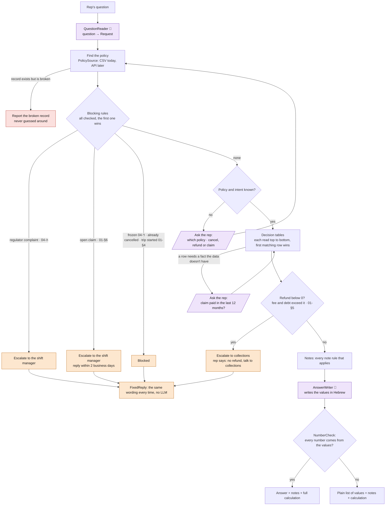

# Rep assistant

A CLI for insurance customer-service reps. The rep types a free-text question
(Hebrew or English), for example `לקוח 4471 רוצה לבטל, מה מגיע לו?`. The tool answers
from that policy's data and the company's procedures. If a case is above the rep's
authority, it routes it to a manager instead of answering.

## Requirements

- Python 3.12+
- An OpenAI API key in `code/.env`: `OPEN_AI_API_KEY=...` (`OPENAI_API_KEY` also works)
- The input data in `data/` (`policies.csv` and `policies/*.md`), which is not committed
- `code/config.json`: the model (`gpt-4.1-mini`), the CSV path, and the date the tool treats as "today"

## Setup and run

```bash
cd code
python3 -m venv .venv
.venv/bin/pip install -r requirements.txt

.venv/bin/python -m assistant "לקוח 4471 רוצה לבטל, מה מגיע לו?"   # one question
.venv/bin/python -m assistant                                      # interactive; empty line exits
```

When something is missing, the tool asks the rep a follow-up question in the same
conversation, so the rep doesn't have to ask again from the start:

- which policy, when the customer has several (only their policy IDs are accepted);
- the policy number, when none was given or it wasn't found;
- whether the question is about a cancellation, a refund or a claim, when that's unclear;
- for some health policies, whether a claim was paid in the last 12 months
  (`כן` / `לא` / `לא יודע`, i.e. yes / no / don't know).

Answers are checked by code, not the model; an invalid one is asked again. An empty
line skips the question, and the tool says what's missing.

## Tests and evals

```bash
.venv/bin/pytest                         # unit tests: every rule, the engine, the workers (no LLM)
.venv/bin/python -m evals.run --offline  # 31 rep questions against the rules (no LLM, no key)
.venv/bin/python -m evals.run            # the same questions end to end with the real model
.venv/bin/python -m evals.sample         # prints the 15 sampled policies (see below)
```

`evals/cases.yaml` has two parts:

- **Policy sample (15 cases):** 25% of the policies, picked at random by
  `evals/sample.py` with a fixed seed, so the same 15 come out every time. The only part
  that isn't random: one travel policy with a future trip and one health policy are
  drawn first, because they have rules of their own. Each expected value was worked out
  by hand from the procedures and the policy's CSV row, and the calculation is written
  next to the case, so a reviewer can check every case without trusting the tool.
- **Conversation cases (16 cases):** what the model must understand (a regulator threat,
  a claim question, a missing policy number) and how the tool talks to the rep. They
  check the outcome and the wording, not amounts.

The unit tests (`pytest`) cover the rules the sample doesn't happen to hit, such as
arrears (4412), a frozen policy (4455) and the multi-policy discount (4418).

Each case checks:

- what the model extracted from the question;
- the outcome (answer, blocked, escalate, or missing info) and the deciding rule;
- every calculated value;
- that each required note appears in the answer;
- text the answer must or must not contain (e.g. an amount that must not be given);
- that it answered within 30 seconds.

The full run with the model hasn't been redone on this set yet; offline, 31/31 pass.
Time the rep spends answering a follow-up question isn't counted.

## How it works

The LLM is used twice: to read the question into a fixed form, and to word the answer.
Everything in between is plain code: finding the policy, blocking rules, calculations
(the rulebook in `code/assistant/rules/rulebook.py`, each rule cites its procedure section).

- **Escalations and blocks** use fixed wording, with no LLM.
- **Every number** in a written answer is checked against the calculated values. If one
  doesn't match, the tool shows a plain list of the values instead.
- **Notes the rep must pass on** are added by code, word for word.
- **The full calculation** is added by code at the bottom of every answer: each value
  with its inputs and the rule behind it (e.g. `0 (חלק יחסי) − 150 (דמי ביטול) + 492
  (מענק ותק) − 0 (חוב) = 342 ₪`), so the rep can check it by eye. Each rule writes
  its own explanation, so the explanation can't drift from what was actually computed.

See [`architecture.md`](docs/architecture.md) and [`DECISIONS.md`](docs/DECISIONS.md).

### The flow



### One decision table: the seniority bonus rate

Each calculated value has its own table. Exceptions sit above the general rule, so they
win. Every table, the blocking rules and the notes are drawn in [`rulebook.md`](docs/rulebook.md).

Columns read the way the engine does: the condition, then what it asks the rep, then the
result. Rows are read top to bottom; the first one that matches gives the rate.

| # | Rule | When | Asks the rep | Rate |
|---|---|---|---|---|
| 1 | 02-§2ג | seniority under 12 months | no | 0% |
| 2 | 02-§3 | health policy | "Was a claim paid to the customer in the last 12 months?" | yes → 0%<br>no → by seniority bracket<br>doesn't know → **UNKNOWN** |
| 3 | 02-§2ג | any other case | no | by seniority bracket |

| Seniority bracket (02-§2ג) | Rate |
|---|---|
| 12–35 months | 5% |
| 36–60 months | 10% |
| 61+ months | 15% |

The same table as pseudo code:

```
if seniority < 12 months:   rate = 0%                 # 02-§2ג
elif product == health:     ask "claim paid in last 12 months?"
                              yes → 0%
                              no  → bracket rate
                              don't know → UNKNOWN    # 02-§3
else:                       rate = bracket rate       # 02-§2ג
```

## What works

- Cancellation and refund questions:
  - cancellation date (including 30 days' notice for older health policies, and immediate cancellation in the 14-day cooling-off period, which travel policies
    don't have: they can be cancelled free of charge until the day before the trip);
  - cancellation fee (including the flat ₪150 car fee);
  - seniority bonus and refund estimate, always marked as an estimate.
- Escalation to the shift manager:
  - a regulator complaint is mentioned (also detected by keywords, so it doesn't depend on the model);
  - cancelling a policy with an open claim.
- Escalation to collections (מחלקת גבייה): the refund comes out below 0, because the
  cancellation fee or the estimated debt (unpaid months × monthly premium) is larger than
  it. The rep says only that there is no refund and the customer should talk to
  collections, with no amounts.
- Blocks:
  - frozen policy;
  - trip already started;
  - policy already cancelled.
- Warnings:
  - the multi-policy discount is lost;
  - the customer is in arrears;
  - a written cancellation request is required.
- Claim questions:
  - service times (acknowledgement in 3 business days, assessor in 10);
  - required documents for each product;
  - what may not be disclosed.
- Missing information is asked for in the same conversation (see above). A broken data
  row is reported, never guessed around.

## What doesn't (by design: the data isn't there)

- **Claim payment date and claim stage.** The procedure gives no payment timeline, and
  the CSV only counts open claims. The answer says these are unknown.
- **The amount paid in the cooling-off period.** Not in the data, so the refund is shown
  as unknown rather than guessed.
- **Prepaid premium and exact debt.** The CSV doesn't say how far ahead a customer has
  paid. The tool assumes the last payment covers its own month, and says so. The debt of a
  customer in arrears is estimated from that assumption (every month after it, this one
  included, is unpaid); the exact amount is set by collections.
- **Refunds outside a cancellation** (double charges, reduced cover) aren't handled.
- **The written cancellation request** is assumed to arrive today.

These are the open questions for the client in [`QUESTIONS.md`](docs/QUESTIONS.md).
