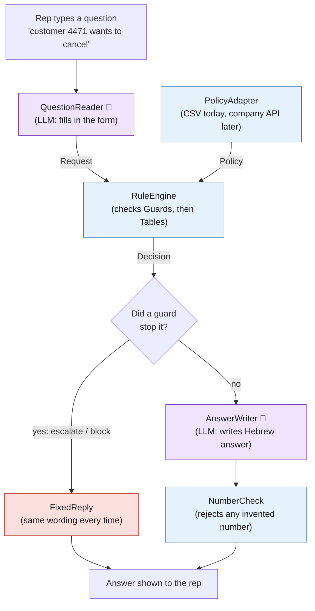
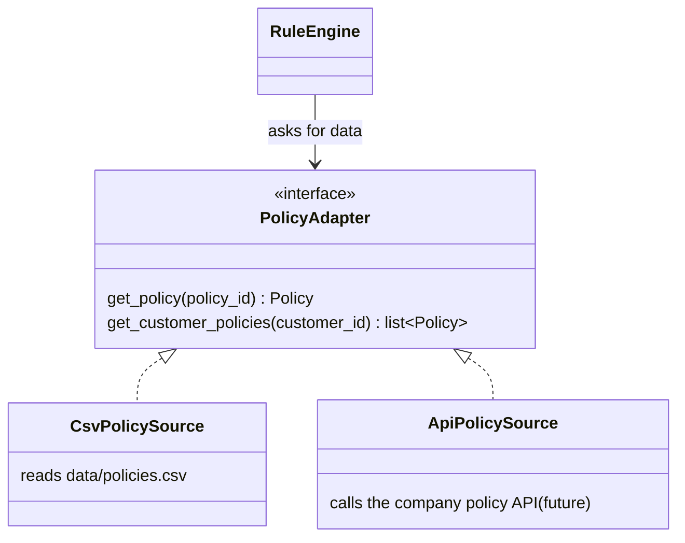

# Architecture

> Status: **built**, in `code/assistant/`. The rules are in `rules/rulebook.py`; `pipeline.py` wires the workers together.
> Two additions to the picture below: if the written answer fails NumberCheck, the rep gets a plain list of the
> values instead; and the notes the rep must pass on are added word for word by code, never by the LLM.

## The idea in one picture

Think of the tool as a small insurance office with five roles:

- A **receptionist** listens to the rep's question and fills in a form.
- A **records clerk** pulls the customer's policy from the filing cabinet.
- A **rule checker** follows the company rulebook to the letter.
- A **standard notice** is stamped when the case must go to a manager.
- A **letter writer** turns the checker's result into a friendly Hebrew answer.

Only the receptionist and the letter writer are AI (an LLM). Everyone in between follows fixed rules. They never guess, and they always give the same answer to the same input.

🤖 = uses the LLM. Everything else is plain code that can be tested.

## Three kinds of classes

**1. Forms (data classes).** They only hold information and do nothing on their own. Like a paper form, they are filled in by one class and read by the next.

| Class | What it holds |
|---|---|
| `Request` | What the rep asked: the policy ID, the intent (cancel / refund / claim), and whether a regulator complaint was mentioned. |
| `Policy` | One policy's record: product, status, start date, open claims, last payment. |
| `Decision` | The result: outcome, values (fee, dates, refund estimate), warnings, and which rules were used. |
| `UNKNOWN` | A special value meaning "we don't know". It is used instead of guessing. Anything calculated from it is also `UNKNOWN`. |

**2. Workers (service classes).** Each one does one job. They are the roles in the picture above.

| Class | Job |
|---|---|
| `QuestionReader` | Turns free text into a `Request` (LLM). |
| `RuleEngine` | Takes a `Request` and a `Policy` and produces a `Decision`. |
| `FixedReply` | Turns an escalation or block into a fixed message: reason, rule, who to send it to, and the time limit. |
| `AnswerWriter` | Turns a `Decision` into a Hebrew answer (LLM). |
| `NumberCheck` | Makes sure every number in the answer comes from the `Decision`. |

**3. Rules (the rulebook).** Each rule is a short entry that cites the procedure it comes from (e.g. `04-א`).

- A **`Guard`** is a stop sign: "open claim → send to manager", "frozen policy → can't cancel". The engine checks *all* guards. If several match, the most important one wins and the others are listed too.
- A **`Table`** of **`Row`s** calculates one value, such as the cancellation fee. The engine reads the rows from top to bottom and uses the first one that matches. Exceptions sit above the normal rule, so they win:

  | Row | When | Fee |
  |---|---|---|
  | 01-§2 | within 14 days of start | ₪0 |
  | 04-א | car policy | ₪150 |
  | 01-§3 | 12+ months of seniority | ₪0 |
  | 01-§3 | otherwise | ₪50 |

  Adding a new company rule means adding one row.

Look for docs/decision_table.ods for an example of a decision table. 

## The plug socket: `PolicyAdapter`

`PolicyAdapter` is an **interface**: a promise of what a class can do ("give me policy X"), without saying how. Think of a wall socket. Any appliance with the right plug works.

`CsvPolicySource` exists today. Moving to the company API means writing `ApiPolicySource` and changing one line of setup. `RuleEngine` doesn't change, because it only knows the socket, not what's plugged in.

## Why it's built this way

- **No invented answers.** Facts about the policy come only from `PolicyAdapter`, and amounts come only from the rule tables. The LLM just reads and writes text.
- **Escalations are always worded the same.** `FixedReply` doesn't use the LLM.
- **Easy to test.** Every guard and table row can be checked on its own, without calling the LLM.
- **Fast.** At most two LLM calls per question. The rules themselves run instantly.

More detail on these choices is in [`DECISIONS.md`](DECISIONS.md).
