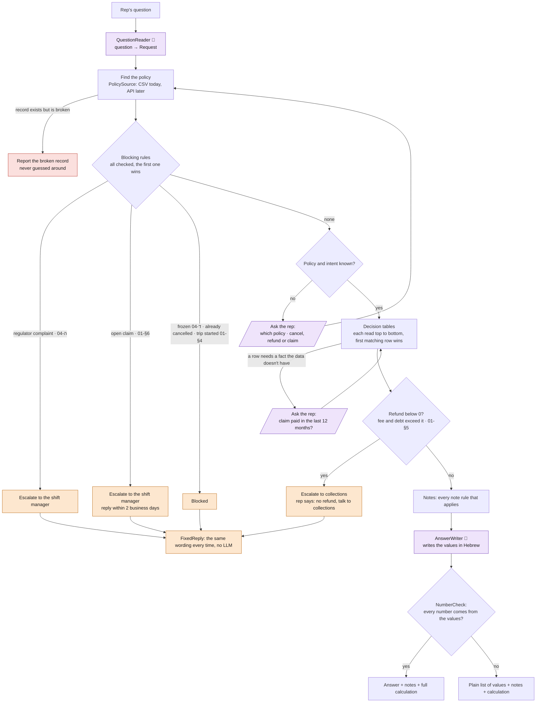

# The rulebook

The rules in `code/assistant/rules/rulebook.py`: the full flow as a diagram, every rule as a
table. Each rule cites its procedure section: `01` cancellation, `02` refunds, `03` claims,
`04` exceptions. A snapshot for reading; the code is the source of truth.

In the flow: 🟪 LLM or asks the rep · 🟧 escalate or block · 🟥 broken record. In the tables,
**UNKNOWN** means the value can't be worked out from the data, and is never guessed.

## 1. The whole flow

## 2. Blocking rules

All of them are checked, in this order: the first match decides the outcome, and the
others are listed as further reasons. A rule is checked only for the questions it applies
to; for the rest it is skipped. Rows 1–5 run before any calculation; row 6 needs the
calculated refund, so it runs after the tables.

| # | Rule | Applies to | When | Outcome |
|---|---|---|---|---|
| 1 | 04-ה | all questions | a regulator complaint is mentioned (even with no policy) | escalate: shift manager |
| 2 | 01-§6 | cancel, refund | the policy has an open claim | escalate: shift manager, reply within 2 business days |
| 3 | 04-ד | cancel, refund | the policy is frozen | blocked: unfreeze via collections first |
| 4 | policy status | cancel, refund | the policy is already cancelled | blocked: check the refund with finance |
| 5 | 01-§4 | cancel, refund | travel, and the trip starts today or has started | blocked: no cancellation, no refund |
| 6 | 01-§5 | cancel, refund | the refund is known and below 0 (the fee and any debt are larger than it) | escalate: collections. The rep says "no refund, talk to collections", with no amounts |

## 3. Cancellation and refund tables

These tables apply to cancel and refund questions only. They run in this order, so a later
table can read an earlier one's value. In each table, rows are read top to bottom and the
first one that matches gives the value. Columns read the way the engine does: the
condition, then anything it asks the rep, then the result.

### Cooling-off period

| # | Rule | When | In cooling-off |
|---|---|---|---|
| 1 | 01-§4 | travel policy (its own limit: until the day before the trip) | no |
| 2 | 01-§2 | any other case | yes if 14 days or fewer since the start (a policy not started yet counts), otherwise no |

### Effective date

| # | Rule | When | Effective date |
|---|---|---|---|
| 1 | 01-§2 | in the cooling-off period | today (immediate) |
| 2 | 01-§4 | travel, and the trip starts by the end of this month | **UNKNOWN**: month end would fall after the trip starts |
| 3 | 04-ב | health policy started before 01/01/2024 | today + 30 days |
| 4 | 01-§1 | any other case | end of this month |

### Cancellation fee

| # | Rule | When | Fee |
|---|---|---|---|
| 1 | 01-§2 | in the cooling-off period | ₪0 |
| 2 | 01-§4 | travel policy (before the trip; a started trip is blocked) | ₪0 |
| 3 | 04-א | car policy | ₪150, any seniority |
| 4 | 01-§3 | seniority 12 months or more | ₪0 |
| 5 | 01-§3 | any other case | ₪50 |

### Seniority bonus rate

| # | Rule | When | Asks the rep | Rate |
|---|---|---|---|---|
| 1 | 02-§2ג | seniority under 12 months | no | 0% |
| 2 | 02-§3 | health policy | "Was a claim paid to the customer in the last 12 months?" | yes → 0% no → by seniority bracket doesn't know → **UNKNOWN** |
| 3 | 02-§2ג | any other case | no | by seniority bracket |

| Seniority bracket (02-§2ג) | Rate |
|---|---|
| 12–35 months | 5% |
| 36–60 months | 10% |
| 61+ months | 15% |

### Prorated premium

"Paid through" is the end of the month of the last payment: premiums are taken to be
monthly (QUESTIONS #1). 

| # | Rule | When | Prorated premium |
|---|---|---|---|
| 1 | 01-§2 | in the cooling-off period | **UNKNOWN**: full refund of what was paid, but the amount paid isn't in the data |
| 2 | 02-§2א | paid through the effective date or earlier | ₪0 |
| 3 | 02-§2א | any other case (prepaid past cancellation) | **UNKNOWN**: finance works it out |

### Arrears debt

| # | Rule | When | Debt |
|---|---|---|---|
| 1 | 01-§5 | more than 60 days since the last payment | unpaid months × monthly premium: from the month after "paid through" to this month, not before the start |
| 2 | 01-§5 | any other case | ₪0 |

### Refund

`balance = prorated premium − cancellation fee + seniority bonus − arrears debt`

If any part of the balance is unknown, the refund is **UNKNOWN**, with that part's reason.

| # | Rule | When | Refund | Then |
|---|---|---|---|---|
| 1 | 02-§2 | balance below 0 (from the fee, the debt, or both) | ₪0 | escalate to collections (blocking rule 6): "no refund, talk to collections" |
| 2 | 02-§2 | any other case | balance | answer |

The rep never sees a negative amount, and never an amount to pay.

### Values with a single rule

| Value | Rule | How |
|---|---|---|
| Seniority (months) | 02-§2ג | whole months from the start date to today |
| Seniority bonus | 02-§2ג | rate × monthly premium × 12 |
| Days since the last payment | 01-§5 | today − last payment date (over 60 = arrears) |
| Refund transferred within | 02-§4 | 14 business days |

## 4. Claim questions

These tables apply to claim questions only. Each value has a single rule. What the data or
the procedure doesn't give stays unknown.

| Value | Rule | Value given |
|---|---|---|
| Open claims | 03-§3 | the count from the policy data |
| Claim stage | 03-§3 | **UNKNOWN**: not in the data |
| Acknowledgement | 03-§2 | within 3 business days |
| Assessor appointed | 03-§2 | within 10 business days |
| Claim payment date | 03-§2 | **UNKNOWN**: the procedure sets no timeline |

## 5. Notes

Every note that applies is added word for word under the answer, by code.

| Rule | Applies to | When | Note |
|---|---|---|---|
| 01-§1 | cancel | always | cancellation needs a written request |
| 04-ג | cancel, refund | the customer has another policy that isn't cancelled | the 5% multi-policy discount is lost |
| 04-ב | cancel, refund | the effective date came from the 30-day health rule | 30 days' notice, and the customer pays for them |
| 01-§4 | cancel, refund | travel policy | cancellable free of charge only until the day before the trip |
| 02-§2א | cancel, refund | the prorated part used the monthly-payment assumption | the assumption, stated |
| 01-§5 | cancel, refund | in arrears | the debt is offset against the refund |
| 01-§5 | cancel, refund | in arrears, "paid through" not in the data | how the debt was estimated |
| 02-§5 | cancel, refund | always | every amount is an estimate |
| 03-§6 | claim | always | no approval odds, no amounts, no assessor recommendation |
| 03-§4 | claim | always, per product | the documents needed |
